<div align="center">


# Sofra — Restaurant Order Processing

**A real-time restaurant point-of-sale built with Spring Boot 4 and Java 21.**<br>
Waiters take orders at the till, tickets land on the kitchen display the instant they are placed,
the floor plan tracks every open check, and the manager watches it all on a live dashboard.

[](https://github.com/UmutVarol/Restaurant-Order-Processing/actions/workflows/ci.yml)


</div>

---

## Contents

- [Highlights](#highlights)
- [Screenshots](#screenshots)
- [Quick start](#quick-start) · [in-browser demo](#without-installing-anything)
- [Architecture](#architecture)
- [Engineering decisions](#engineering-decisions)
- [REST API](#rest-api)
- [Testing](#testing)
- [Configuration](#configuration)
- [Project history](#project-history)
- [Türkçe özet](#türkçe-özet)

## Highlights

| | |
|---|---|
| 🧾 **Point of sale** | Menu grid with search, category and dietary filters · dine-in / takeaway / delivery · table picker with live occupancy · per-line kitchen notes · coupons · prices quoted live by the server · free-delivery progress · <kbd>Ctrl</kbd>+<kbd>Enter</kbd> to send |
| 👩‍🍳 **Kitchen display** | Kanban board fed by **Server-Sent Events** — no polling, no refresh · SLA timers that turn amber and red · one-tap status changes · new-ticket highlight and optional chime |
| 🪑 **Floor plan** | Every table with its seats, open check, status and time seated · tap a free table to start an order for it |
| 📋 **Orders** | Paginated history with full-text search (order #, guest, phone, table, address), status/type/date filters · detail drawer with audit timeline · cancel with reason · printable receipt |
| 📈 **Dashboard** | Revenue, orders, average ticket and kitchen time with period-over-period trends · daily revenue · busiest hours · category mix · best sellers · channels and payment methods |
| 🍽️ **Menu management** | Create, edit and archive dishes · sold-out toggle · popularity and dietary tags · history-safe soft deletes |
| 🔐 **Security** | Stateless JWT (HS256) with three roles — **Manager**, **Waiter**, **Kitchen** — enforced on every endpoint |
| 🌗 **Polish** | Light & dark themes · English & Turkish · responsive down to phones · keyboard shortcuts · accessible markup |

## Screenshots

| Point of sale | Kitchen display (dark) |
|---|---|
| 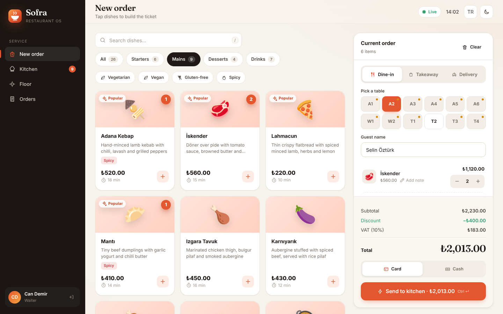 | 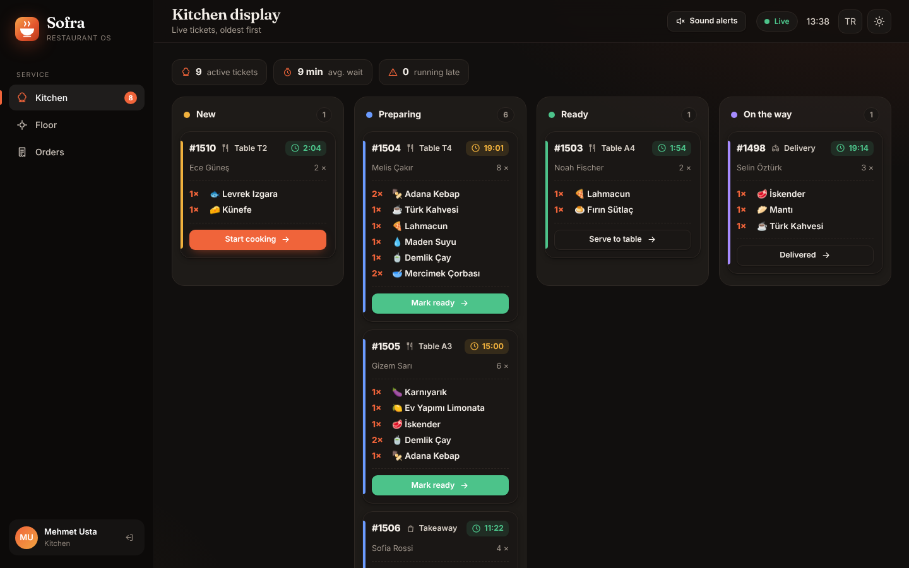 |
| **Manager dashboard** | **Floor plan** |
| 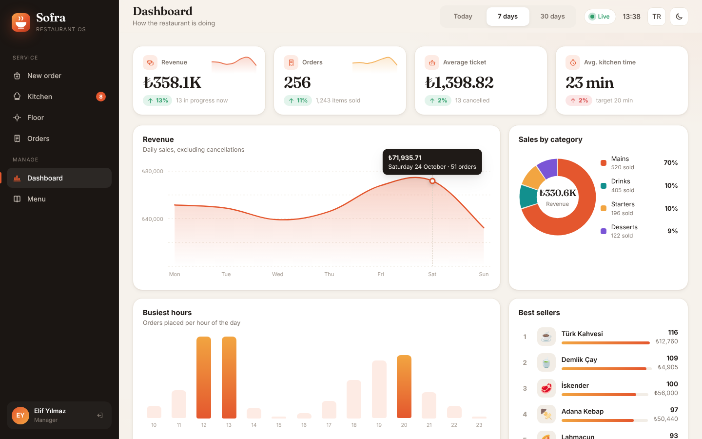 | 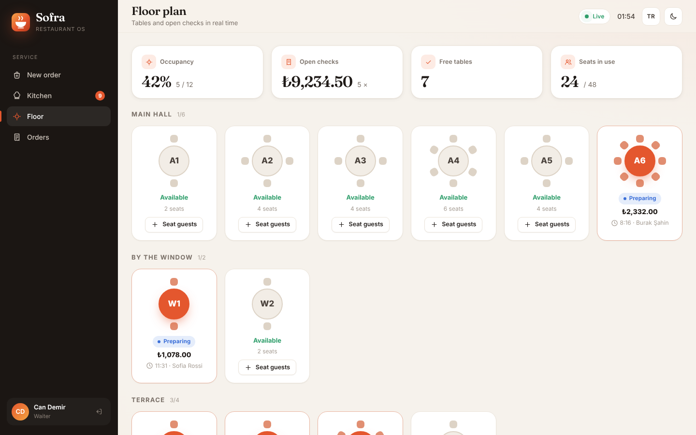 |
| **Order detail & audit trail** | **Menu management** |
| 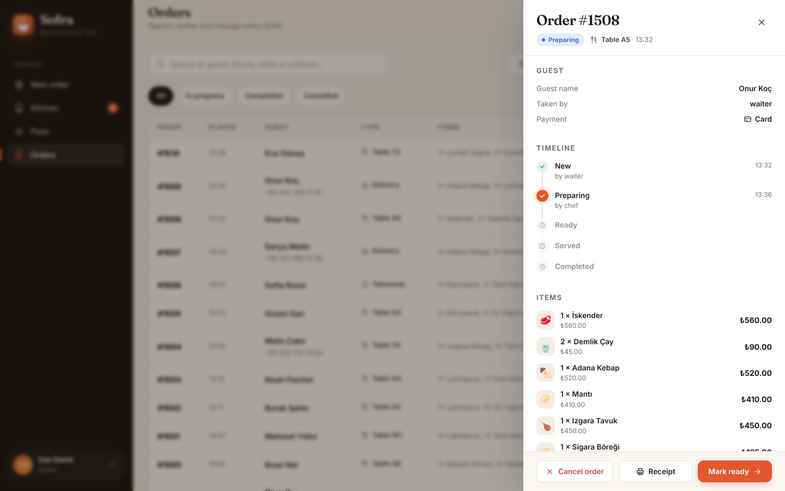 | 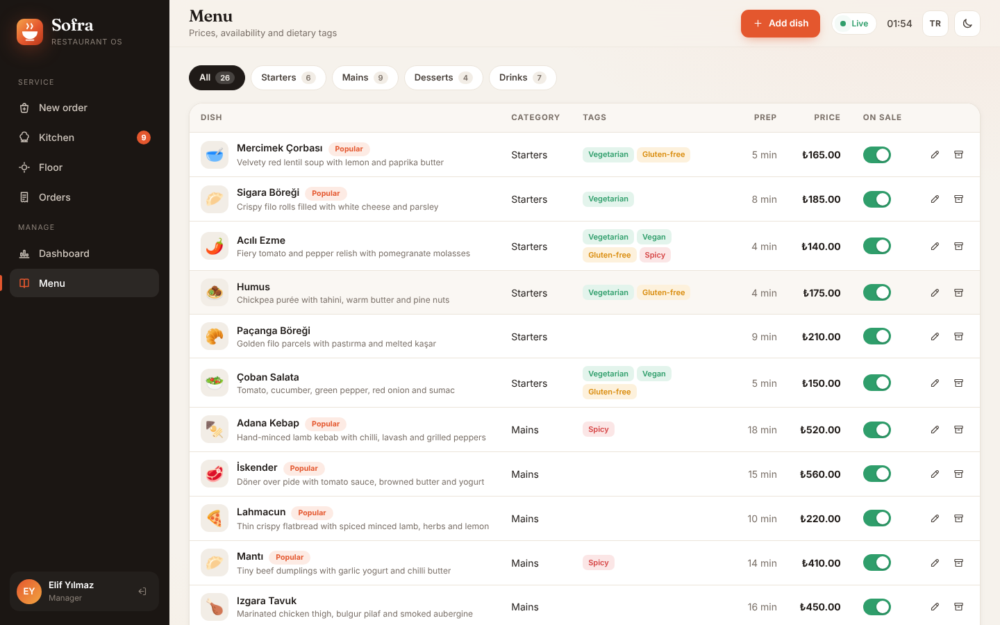 |
| **Sign in** | **Türkçe, koyu tema** |
| 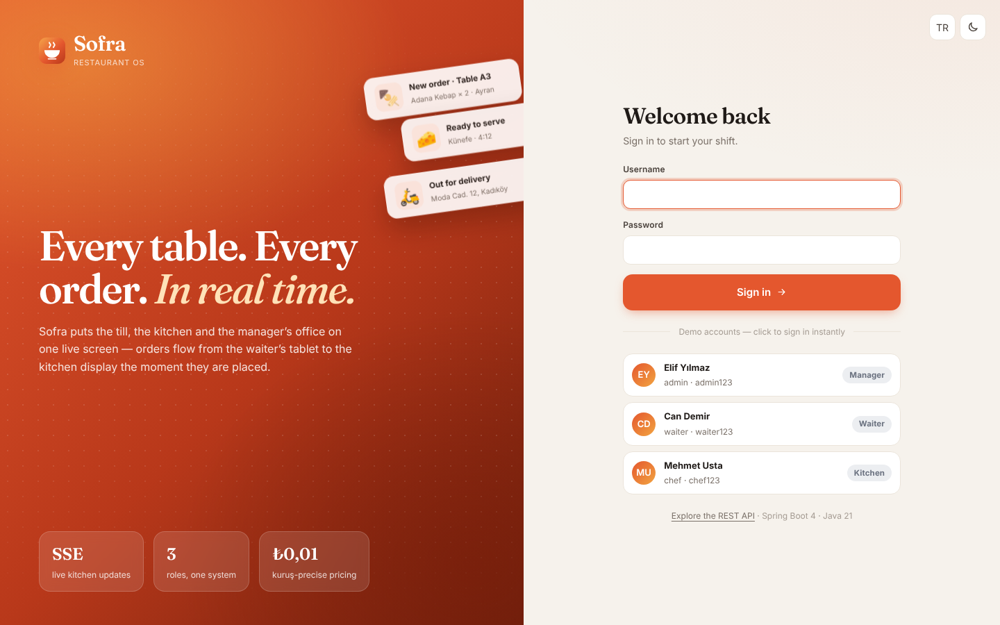 | 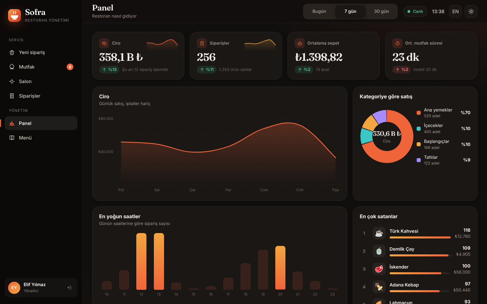 |

<p align="center">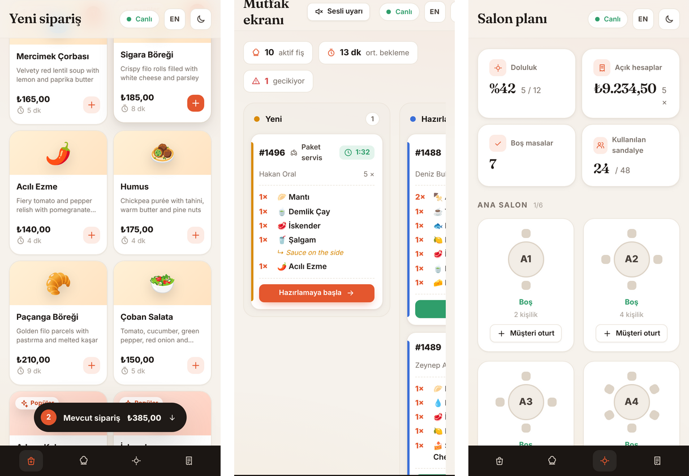</p>

## Quick start

**Requirements:** Java 21. Nothing else — Maven is bundled through the wrapper and the default database is an in-memory H2.

```bash
git clone https://github.com/UmutVarol/Restaurant-Order-Processing.git
cd Restaurant-Order-Processing
./mvnw spring-boot:run          # Windows: mvnw.cmd spring-boot:run
```

Open **http://localhost:8080** and pick a demo account:

| Role | Username | Password | Lands on |
|---|---|---|---|
| Manager | `admin` | `admin123` | Dashboard — everything is available |
| Waiter | `waiter` | `waiter123` | Point of sale, kitchen, floor, orders |
| Kitchen | `chef` | `chef123` | Kitchen display, floor, orders |

> **Tip:** sessions are per browser tab — sign in as the waiter in one tab and the chef in another, send an order
> from the till and watch it appear on the kitchen display.

Demo mode generates two weeks of realistic history on start-up (lunch and dinner rushes, busier weekends,
coupons, cancellations) plus a handful of orders from the last half hour, so every screen has something to show.

### Without installing anything

[`demo/`](demo) holds a static build of the same web client wired to an in-browser simulation of the API
([`mock-backend.js`](demo/mock-backend.js) — same endpoints, pricing, roles, validation, error codes and event
stream). Tabs share the simulated restaurant, so a waiter tab and a chef tab behave like two devices.
To publish it on GitHub Pages: *Settings → Pages → Source: GitHub Actions*, then run the **Deploy demo** workflow.

### With Docker and PostgreSQL

```bash
docker compose up --build       # app + PostgreSQL 16 → http://localhost:8080
```

### Useful URLs

| | |
|---|---|
| Web app | http://localhost:8080 |
| Swagger UI | http://localhost:8080/swagger-ui.html |
| OpenAPI spec | http://localhost:8080/v3/api-docs |
| Health | http://localhost:8080/actuator/health |
| Prometheus metrics (Manager) | http://localhost:8080/actuator/prometheus |

## Architecture

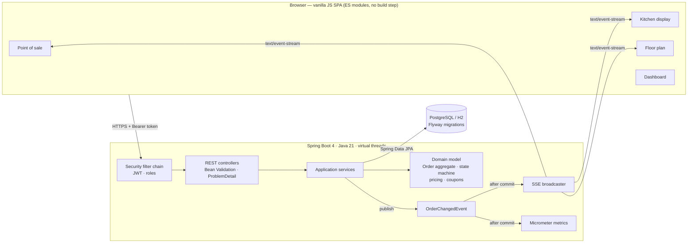

The code is organised **by feature**, not by layer. Each package owns its entities, repositories, services,
controllers and DTOs, and [ArchUnit tests](src/test/java/com/umutvarol/restaurant/ArchitectureTest.java) keep the
dependencies between them acyclic.

```text
com.umutvarol.restaurant
├── menu        dishes, categories, dietary tags, availability
├── table       dining tables and zones
├── coupon      promo codes; percentage and fixed discounts (strategy enum)
├── order       Order aggregate, status state machine, pricing, search, events, metrics
├── floor       live table occupancy (reads tables + orders)
├── realtime    Server-Sent Events broadcaster
├── analytics   dashboard KPIs and aggregate queries
├── security    JWT issuing/validation, users, roles, RFC 9457 auth errors
├── bootstrap   demo accounts and demo data generator
└── common      money, errors, paging, OpenAPI, clock
```

### Order lifecycle

The path an order takes depends on how it is fulfilled. Transitions are enforced by the `Order` aggregate,
every change is recorded with who made it and when, and concurrent edits are caught with optimistic locking.

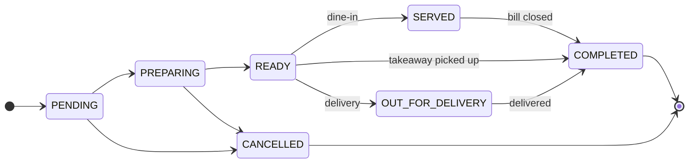

## Engineering decisions

- **Money is `BigDecimal`, never `double`.** Two fraction digits, half-up rounding, `NUMERIC(12,2)` in the database.
  A single [`PricingCalculator`](src/main/java/com/umutvarol/restaurant/order/pricing/PricingCalculator.java) prices
  both the live quote at the till and the persisted order, so guests are charged exactly what they were shown.
- **Order lines snapshot the dish.** Name, icon, category and unit price are copied when the order is placed, so
  editing or archiving a dish never rewrites history or old receipts. Dishes are archived, not deleted.
- **A rich domain model.** `Order.place(...)`, `advance(...)` and `cancel(...)` enforce the business rules; there are
  no public setters. Services orchestrate, entities decide.
- **Events after commit.** Services publish `OrderChangedEvent`; the SSE broadcaster and the metrics listen with
  `@TransactionalEventListener`, so screens are never told about data that is later rolled back.
- **SSE over `fetch`.** `EventSource` cannot send an `Authorization` header, so the client reads the stream with
  `fetch` and a small parser, reconnecting with exponential back-off.
- **Errors are data.** Every error is RFC 9457 `application/problem+json` with a stable `code`
  (`COUPON_EXPIRED`, `ORDER_NOT_CANCELLABLE`, …) and parameters. The UI translates codes, so the API stays
  language-neutral.
- **Preview without side effects.** Coupon validation returns a result object instead of throwing across the
  transactional boundary — a thrown exception would mark the caller's transaction rollback-only (a real bug the
  integration tests caught).
- **Stateless JWT security.** HS256 tokens signed with a configurable secret, roles in a `roles` claim, issuer and
  expiry verified with an injectable `Clock`. CSRF is unnecessary because nothing is authenticated by cookies.
  A strict Content-Security-Policy and the usual security headers are sent on every response.
- **Validation at the edge, invariants in the core.** Bean Validation on request records — including a custom
  class-level constraint, [`@ValidFulfilment`](src/main/java/com/umutvarol/restaurant/order/validation/ValidFulfilment.java),
  that reports a missing table or address field by field — and the same rules re-checked by the aggregate.
- **Portable schema.** Flyway migrations run unchanged on PostgreSQL and H2; Hibernate only validates.
  CHECK constraints guard enums and amounts at the database level too.
- **Observable.** Actuator health probes for orchestration, build info, and business metrics
  (`sofra.orders.placed`, `sofra.orders.transitions`, `sofra.orders.active`) exported to Prometheus.
- **Safe rendering.** The front end builds the DOM with a tiny helper that only ever inserts user data as text
  nodes — no `innerHTML` with guest names or notes.

## REST API

All endpoints live under `/api/v1` and are documented in Swagger UI. Responses are JSON; errors are problem details.

| Method | Path | Who | Purpose |
|---|---|---|---|
| `POST` | `/auth/login` | anyone | Exchange credentials for a JWT |
| `GET` | `/auth/me` | staff | The signed-in user |
| `GET` | `/menu` | anyone | Menu, filterable by `category`, `q` |
| `POST` `PUT` `PATCH` `DELETE` | `/menu/**` | Manager | Manage dishes and availability |
| `POST` | `/orders/quote` | Waiter, Manager | Price a cart (coupon problems are reported, not thrown) |
| `POST` | `/orders` | Waiter, Manager | Place an order |
| `GET` | `/orders` | staff | Search with `status`, `type`, `q`, `from`, `to`, paging and sorting |
| `GET` | `/orders/active` | staff | Everything still in progress, oldest first |
| `POST` | `/orders/{id}/advance` | staff | Move to the next status |
| `POST` | `/orders/{id}/cancel` | Waiter, Manager | Cancel with a reason |
| `GET` | `/floor/tables` | staff | Tables with their open checks |
| `GET` | `/coupons` | staff | Coupons that can be redeemed now |
| `GET` | `/analytics/dashboard?days=7` | Manager | KPIs, trends and breakdowns |
| `GET` | `/events/orders` | staff | `text/event-stream` of order events |

```bash
TOKEN=$(curl -s -X POST localhost:8080/api/v1/auth/login -H 'Content-Type: application/json' \
  -d '{"username":"waiter","password":"waiter123"}' | jq -r .accessToken)

curl -s -X POST localhost:8080/api/v1/orders -H "Authorization: Bearer $TOKEN" -H 'Content-Type: application/json' -d '{
  "type": "DINE_IN", "tableId": 3, "customerName": "Ayşe Kaya", "paymentMethod": "CARD", "couponCode": "HOSGELDIN",
  "items": [{ "menuItemId": 7, "quantity": 2, "note": "extra spicy" }, { "menuItemId": 22, "quantity": 2 }]
}' | jq '{id, status, pricing}'
```

## Testing

```bash
./mvnw verify      # all tests + JaCoCo coverage gate (≥ 80 % lines)
```

**100+ tests, ~95 % line coverage**, in four layers:

| Layer | Examples |
|---|---|
| Domain unit tests | state machine for every order type, pricing and rounding, coupon rules, aggregate invariants, custom validator |
| Service tests (Mockito) | order placement, sold-out and unknown dishes, quotes with invalid coupons, event publication, analytics bucketing across time zones |
| Full-stack API tests (MockMvc) | real JWT login, role-based access (401 / 403), validation problems, the whole dine-in and delivery lifecycles, search, floor occupancy, SSE stream, security headers |
| Architecture & database | ArchUnit rules (no cycles, controllers never touch repositories, entities know nothing about the web) · **Testcontainers PostgreSQL** run of migrations, demo data and aggregate queries |

CI runs everything on every push, then builds the Docker image and smoke-tests the running container.

## Configuration

| Variable | Default | Description |
|---|---|---|
| `JWT_SECRET` | dev-only value | HS256 signing key, **≥ 32 characters — set it in production** |
| `DEMO_MODE` | `true` | Create demo accounts and history on an empty database |
| `SPRING_PROFILES_ACTIVE` | — | `postgres` to use PostgreSQL |
| `DATABASE_URL` / `DATABASE_USERNAME` / `DATABASE_PASSWORD` | `jdbc:postgresql://localhost:5432/sofra` | PostgreSQL connection (with the `postgres` profile) |
| `RESTAURANT_BOOTSTRAP_ADMIN_PASSWORD` | — | Creates an `admin` account on first start when demo mode is off |
| `PORT` | `8080` | HTTP port |

Business rules — tax rate, delivery fee, free-delivery threshold, time zone — are under `restaurant.*` in
[`application.yml`](src/main/resources/application.yml) and validated on start-up.

## Project history

Sofra started life as a **Java Swing desktop app** for the SWE312 course: one window, an in-memory order list
and `double` arithmetic. Version 2 rebuilds it as a production-style full-stack system. The original is kept in
[`legacy/swing-desktop`](legacy/swing-desktop) for comparison.

<details>
<summary>v1 — the original Swing application</summary>

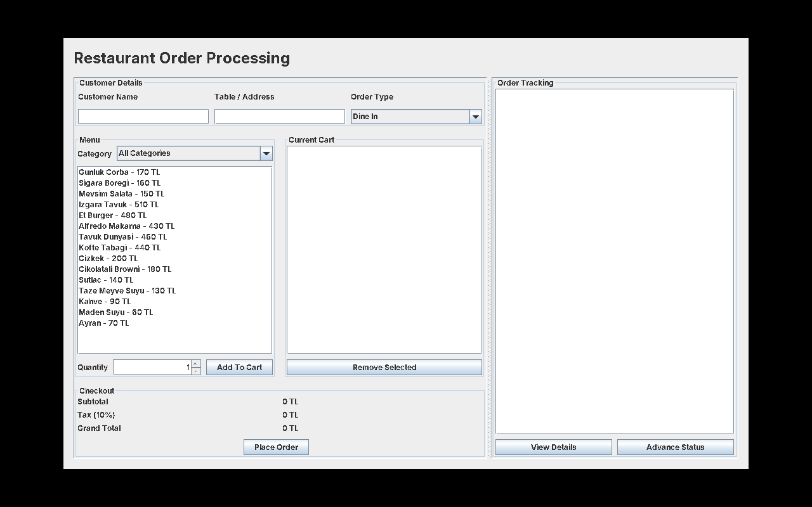

</details>

## Türkçe özet

**Sofra**, Spring Boot 4 ve Java 21 ile geliştirilmiş, gerçek zamanlı bir restoran sipariş ve POS sistemidir.

- **Garson** kasadan (POS) masaya, gel-al ya da paket servis siparişi girer; fiyatlar ve kuponlar sunucuda anlık hesaplanır.
- Sipariş, **Server-Sent Events** sayesinde sayfa yenilemeden anında **mutfak ekranına** düşer; şef tek dokunuşla durumu ilerletir.
- **Salon planı** hangi masanın dolu olduğunu, açık hesabı ve oturma süresini canlı gösterir.
- **Yönetici paneli** ciro, sipariş sayısı, ortalama sepet ve mutfak süresini önceki dönemle karşılaştırır; en yoğun saatleri ve en çok satanları gösterir.
- JWT ile rol bazlı yetkilendirme (Yönetici / Garson / Mutfak), Flyway, PostgreSQL, Docker, OpenAPI, Prometheus metrikleri.
- 100'ü aşkın test (birim, entegrasyon, mimari, Testcontainers) ve ~%95 kod kapsamı.
- Açık/koyu tema, Türkçe/İngilizce arayüz, mobil uyumlu tasarım.

Çalıştırmak için: `./mvnw spring-boot:run` → **http://localhost:8080** (demo hesaplar yukarıdaki tabloda).

## License

[MIT](LICENSE) © Muhammed Umut Varol
