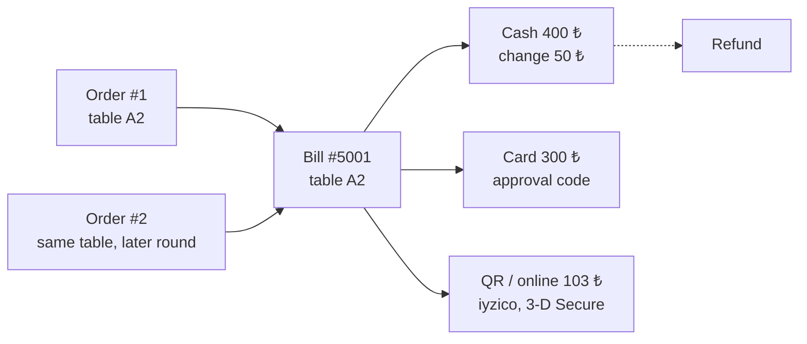
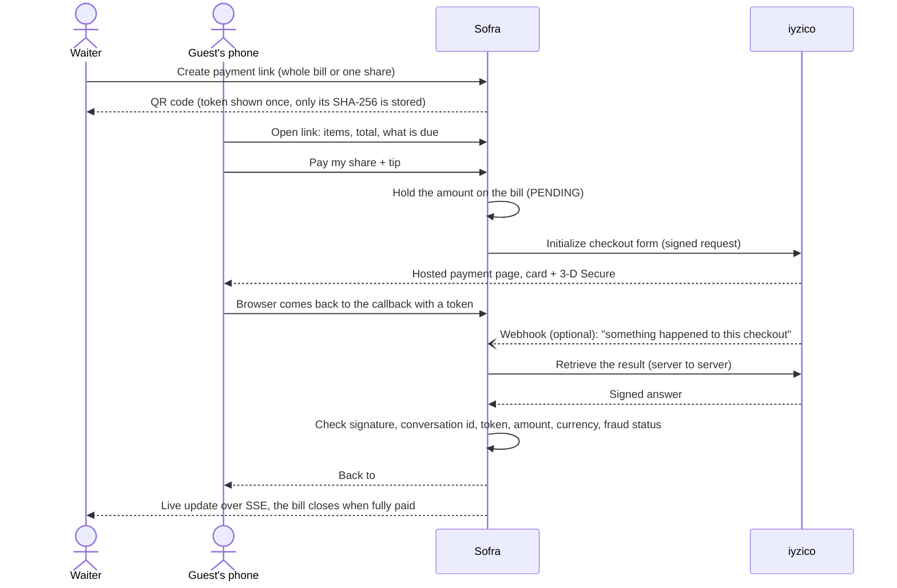

# Payments

How Sofra settles a table: what a bill is, how money is taken at the till and by QR code, and how to go live
with iyzico.

## The model



- **A bill** is what a guest settles: every order of one dine-in seating (later rounds at the same table join the
  open bill), or a single takeaway or delivery order.
- **A payment** is cash, card (taken on the restaurant's own card terminal, with its approval code recorded) or
  online (the guest pays from their phone through iyzico).
- **Tips** are stored next to the payment, never inside it: they are not sales, so they stay out of revenue and VAT.
- **An order can only be completed once its bill is paid.** Paying a dine-in bill in full completes the served
  orders and frees the table. Takeaway and delivery orders still wait for the hand-over, which staff confirm.

The money rules live in one place, the `Bill` aggregate:

```
total     = Σ totals of orders that are not cancelled
paid      = Σ successful payments − refunds
balance   = total − paid                        what is still due
available = balance − online payments in progress what may still be charged
```

| Rule | Error code |
|---|---|
| A payment can never be more than is still due | `PAYMENT_EXCEEDS_BALANCE` |
| Cash handed over must cover the payment and tip; the change is calculated | `CASH_NOT_ENOUGH` |
| A tip cannot be negative or larger than the payment | `TIP_INVALID` |
| A closed bill takes no more money | `BILL_NOT_OPEN` |
| An order cannot be completed while its bill is unpaid | `BILL_NOT_PAID` |
| A refund cannot exceed what is left of the payment | `REFUND_EXCEEDS_PAYMENT` |

Amounts are `BigDecimal` with two decimals, rounded half-up. They are never floating point.

### Safety

- **Two tills, one table.** Every change to a bill's money happens under a database row lock on the bill, so two
  waiters settling the same table at the same moment cannot overcharge it.
- **Retries after a timeout.** The till sends an `Idempotency-Key` with each payment. Sending the same request
  again returns the payment that was already taken instead of charging twice.
- **Cancelled orders.** When an order on a paid bill is cancelled, the excess is refunded automatically, newest
  payment first. Cash and card refunds are recorded as given at the till; online refunds go back through iyzico.

## Paying by QR code



- **Card details never touch Sofra.** The guest types them on iyzico's hosted page, which keeps the restaurant out
  of most of the PCI DSS scope.
- **The callback is not trusted.** It only tells Sofra to ask iyzico. The answer must carry a valid HMAC-SHA256
  signature (compared in constant time), and must be for the same conversation id, checkout token and amount that
  Sofra started. A token replayed from another checkout is refused.
- **Links** are 256-bit random tokens that expire after 2 hours (`restaurant.payments.link-ttl`) and stop working
  once the bill is closed. Only a hash is stored, so a database leak does not hand out working links. The guest
  page shows the items and totals, never staff names or other guests' details.
- **The return address carries no link token.** The guest's phone remembers which link it came from, so the token
  is never seen by iyzico or written to a log on the way back.
- **A share in progress is held.** While a guest is on iyzico's page, that amount cannot be taken a second time at
  the till. A link holds one checkout at a time, and a new one is refused for a minute after the last.
- **Guests who never come back are still recorded.** Unfinished checkouts are checked with iyzico after 2 minutes,
  and an iyzico webhook to `/api/v1/payments/webhook/iyzico` triggers the same check at once. The webhook body is
  not trusted, so it needs no signature to be safe. A checkout still unfinished after 30 minutes (`pending-ttl`) is
  given up. A payment that arrives after that is still recorded, and any overpayment is refunded.
- **Staff can release an abandoned checkout** from the bill (the guest decided to pay cash after all). iyzico is
  asked first; a payment that went through is kept.
- **Fraud review.** A payment iyzico holds for fraud review stays "under review": the money is held and the bill
  waits until iyzico approves (recorded) or rejects it (failed).
- **Refunds iyzico could not be reached for** are retried every few minutes. Each refund is claimed in the database
  before it is sent, so it is never sent twice. A refund iyzico refuses is marked failed and logged, and the amount
  becomes refundable again so a manager can deal with it.
- **Refunds and closing the day need a fresh sign-in** (within 5 minutes); the till asks for the password again.
- **Everything is audited** in the `payment.audit` log, and suspicious events are counted in
  `sofra.payments.suspicious` for alerting. See [SECURITY.md](../SECURITY.md#payments) for the full threat model.

## End of day

The **Cashier** screen lists every open bill. For managers it adds the **Z report** for any day: sales, tips and
refunds per method, and the cash the drawer should hold:

```
expected cash = cash sales + cash tips − cash refunds
```

Closing the day records the counted cash and the difference (`variance`). Each day can be closed once.

> Sofra is not a fiscal device. In Türkiye the legal receipt still comes from a certified ÖKC till or an e-Arşiv
> invoice provider. The Z report here is for reconciling the drawer and the card terminal.

## Going live with iyzico

1. Open a merchant account at [iyzico](https://www.iyzico.com/) and take the **API key** and **secret key** from
   the merchant panel. Sandbox keys come from `sandbox-merchant.iyzipay.com`.
2. Configure the app:

   | Variable | Value |
   |---|---|
   | `PAYMENT_PROVIDER` | `IYZICO` (`NONE` switches online payments off; cash and card still work) |
   | `IYZICO_API_KEY`, `IYZICO_SECRET_KEY` | from the merchant panel |
   | `IYZICO_BASE_URL` | `https://sandbox-api.iyzipay.com` for testing, `https://api.iyzipay.com` live |
   | `PUBLIC_BASE_URL` | the HTTPS address guests reach, e.g. `https://pay.example.com`. Used in QR links and as the callback address |

   In the iyzico merchant panel, set the notification (webhook) address to `PUBLIC_BASE_URL` +
   `/api/v1/payments/webhook/iyzico`.

3. Serve the app over HTTPS only: QR links and the provider callback must never travel over plain HTTP.
4. Test end to end in the sandbox with the test cards listed in iyzico's developer documentation, including a
   declined card and a refund.
5. Keep the secret key in your secret store, never in the repository. The app refuses to start with
   `PAYMENT_PROVIDER=IYZICO` and no keys.

In demo mode the **simulated provider** stands in for iyzico: its "bank page" is a screen of the app where you pick
approve or decline, and nothing is charged. It is refused when demo mode is off, unless
`restaurant.payments.allow-simulated=true` is set for a staging server.

### Why iyzico, and swapping it

iyzico is the most widely used Turkish payment provider, has a hosted checkout with 3-D Secure, and pays out in
TRY. It sits behind the `OnlinePaymentGateway` interface (`startCheckout`, `retrieve`, `refund`), so PayTR, Param or
Stripe can be added as another implementation without touching bills or payments.

## API

| Method | Path | Who | Purpose |
|---|---|---|---|
| `GET` | `/api/v1/bills` | Waiter, Manager | Open bills |
| `GET` | `/api/v1/bills/{id}`, `/api/v1/bills/by-order/{orderId}` | Waiter, Manager | A bill with its orders and payments |
| `POST` | `/api/v1/bills/{id}/payments` | Waiter, Manager | Take cash or card (`Idempotency-Key` header recommended) |
| `POST` | `/api/v1/bills/{id}/links` | Waiter, Manager | Create a QR payment link, for the whole bill or a fixed share |
| `POST` | `/api/v1/bills/{id}/payments/{paymentId}/release` | Waiter, Manager | Give up an unfinished online payment |
| `POST` | `/api/v1/payments/{id}/refunds` | Manager, recent sign-in | Refund part or all of a payment |
| `GET` | `/api/v1/payments/day?date=` | Manager | Z report |
| `POST` | `/api/v1/payments/day/close` | Manager, recent sign-in | Close a day with the counted cash |
| `GET` | `/api/v1/public/pay/{token}` | anyone with the link | What the guest sees |
| `POST` | `/api/v1/public/pay/{token}/checkout` | anyone with the link | Start paying, returns the provider's page |
| `POST` | `/api/v1/payments/callback/{provider}` | the provider | Where the guest's browser returns |
| `POST` | `/api/v1/payments/webhook/{provider}` | the provider | Notification that triggers a check; the body is not trusted |

```bash
curl -s -X POST localhost:8080/api/v1/bills/5001/payments \
  -H "Authorization: Bearer $TOKEN" -H 'Content-Type: application/json' \
  -H "Idempotency-Key: $(uuidgen)" \
  -d '{"method": "CASH", "amount": 400, "tip": 40, "tendered": 500}' | jq '.payment.changeDue'
# 60.00
```

Live screens learn about payments from the same Server-Sent Events stream as orders, as `payment` events.
